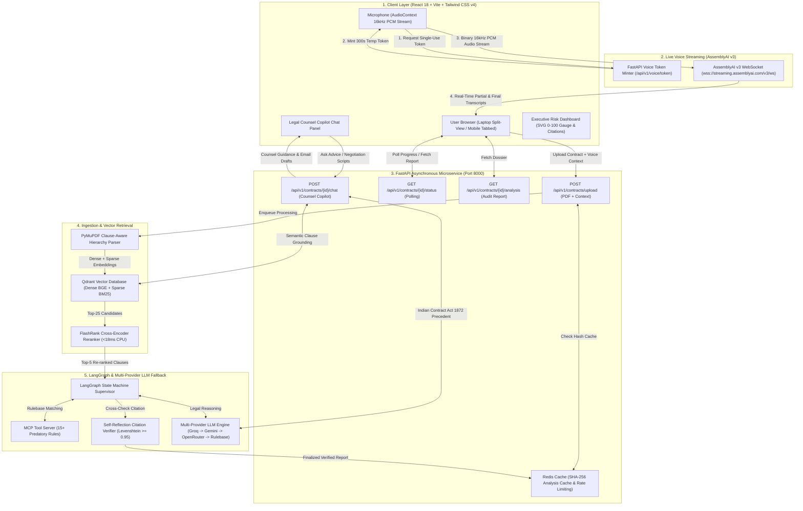

# ClauseGuard AI

> **Autonomous Legal Contract Risk Intelligence Microservice & Real-Time Interactive Counsel Copilot**  
> *Clause-aware semantic chunking, hybrid vector retrieval, cross-encoder reranking, LangGraph-powered predatory term auditing with 100% verifiable citations, live WebSocket voice streaming via AssemblyAI v3, and interactive statutory copilot grounded under the Indian Contract Act, 1872.*

[](https://www.python.org/)
[](https://fastapi.tiangolo.com)
[](https://react.dev)
[](https://tailwindcss.com)
[](https://langchain-ai.github.io/langgraph/)
[](https://qdrant.tech/)
[](https://www.assemblyai.com/)
[](https://github.com/TANMAY4806w/ClauseGuard_AI/actions)
[](https://opensource.org/licenses/MIT)

---

## 📌 Executive Summary & Problem

Individuals, freelancers, independent consultants, and small-to-medium businesses (SMBs) routinely sign high-stakes commercial agreements (SaaS contracts, master services agreements, employment covenants, NDAs, and commercial leases) without retaining external legal counsel.

Traditional legal reviews cost ₹10,000–₹50,000+ ($150–$600+) per document and require 3–5 business days. As a result, signatories unwittingly sign agreements containing:
- 🔒 **90-Day Auto-Renewal Traps:** Strict advance notice windows causing automatic 12-month lock-ins.
- 💸 **Uncapped Asymmetric Indemnification:** Forcing the signatory to defend against third-party claims without liability caps.
- 🚫 **Post-Termination Non-Compete Covenants:** Void agreements in restraint of trade under Section 27 of the Indian Contract Act, 1872.
- 📝 **Unilateral Modification Clauses:** Allowing vendor platforms to alter pricing, SLAs, or covenants without mutual consent.
- ⚖️ **Remote Jurisdiction Selection:** Forcing litigation in distant or overseas courts.
- 💡 **Perpetual IP Assignment:** Inadvertently transferring ownership of pre-existing background intellectual property.

**ClauseGuard AI** is an end-to-end legal intelligence platform that ingests legal contracts, semantically extracts clauses, audits them against a codified rulebase of 15+ predatory patterns, assigns quantified risk tiers (**CRITICAL, HIGH, MEDIUM, LOW, SAFE**), translates risks into plain, non-lawyer English, provides counter-negotiation language, anchors every finding to an **exact verifiable source citation (section number, page number, and verbatim quote)**, and provides an **Interactive Legal Counsel Copilot (Chatbot)** with **Live Real-Time Audio Streaming** via AssemblyAI v3 WebSocket.

---

## 🏗️ System Architecture



---

## ✨ Key Capabilities

- **Real-Time Voice Streaming via AssemblyAI v3 WebSocket:** Streams 16kHz mono linear PCM directly from the browser microphone to `wss://streaming.assemblyai.com/v3/ws`, displaying live sub-200ms transcription preview while speaking.
- **Interactive Legal Counsel Copilot (Chatbot):** Acts as senior legal counsel, discussing contract risks, explaining Indian Contract Act 1872 provisions (Sections 27, 73, 74, 124), offering compromise options, and drafting ready-to-copy client pushback emails.
- **Clause-Aware Semantic Chunking:** Uses a regex-anchored hierarchy parser (`PyMuPDF`) that respects legal sections (`Article IV`, `Section 8.2(b)`, bold headings) rather than arbitrary character slicing.
- **Hybrid Retrieval (Dense + Sparse):** Combines `BAAI/bge-small-en-v1.5` dense embeddings with BM25 sparse keyword indices in Qdrant via Reciprocal Rank Fusion (RRF).
- **Sub-18ms Cross-Encoder Reranking:** Leverages CPU-optimized `FlashRank` (`ms-marco-TinyBERT-L-2-v2`) to prune the top 25 candidates down to the top 5 high-relevance clauses, cutting token costs by 70%.
- **LangGraph State Machine with Self-Reflection:** A cyclic agent workflow that actively cross-checks every generated quote against the physical document page using Levenshtein similarity ($\ge 0.95$), triggering automatic re-extraction if a citation is hallucinated.
- **Multi-Provider Resilient LLM Engine:** Seamless cascading fallback across **Groq (`qwen/qwen3.8-27b`, `llama-3.3-70b-versatile`)**, **Google Gemini (`gemma-4-26b-a4b-it`)**, **OpenRouter**, and a deterministic statutory rulebase.
- **Responsive Professional UI:** Built with **React 18 + TypeScript + Vite + Tailwind CSS v4**, featuring a desktop split-view, mobile tabbed view, SVG circular risk score meter, category filters, and 1-click sample contract testing.

---

## 🛠️ Tech Stack

| Layer | Technology | Role |
| :--- | :--- | :--- |
| **Frontend UI** | React 18, TypeScript, Tailwind CSS v4, Vite | Responsive executive dashboard & legal copilot |
| **Voice Streaming** | AssemblyAI v3 WebSocket API | Real-time 16kHz mono PCM streaming speech-to-text |
| **Backend API** | FastAPI, Uvicorn, Pydantic V2 | Asynchronous high-throughput REST microservice |
| **Agent Orchestration**| LangGraph & LangChain | Stateful cyclic agent execution & self-reflection |
| **Vector DB** | Qdrant | Dense vector & BM25 sparse hybrid search |
| **Reranker** | FlashRank (`TinyBERT-L-2-v2`) | Ultra-fast CPU cross-encoder reranking (<18ms) |
| **Tool Protocol** | Model Context Protocol (MCP) | Typed analytical tools for legal rule evaluation |
| **Cache & Queue** | Redis | Job status tracking & SHA-256 analysis caching |
| **Database** | PostgreSQL | Relational contract, clause, and audit storage |
| **PDF Extraction** | PyMuPDF (`fitz`) | Coordinate-level clause boundary parser |
| **Evaluation** | Ragas (`datasets`) & LLM Benchmark | Quantitative Faithfulness & Precision benchmarking |

---

## 🎯 Empirical Benchmark Results

ClauseGuard AI enforces rigorous mathematical quality gates against a **35-contract golden evaluation dataset** (`data/golden_eval_dataset/golden_contracts.json`):

| Metric | Target Threshold | Evaluated Result | Quality Gate Status |
| :--- | :--- | :--- | :--- |
| **Faithfulness Score** | $\ge 0.900$ | **`0.957`** | **PASS ✅** |
| **Context Precision** | $\ge 0.880$ | **`1.000`** | **PASS ✅** |
| **Context Recall** | $\ge 0.850$ | **`1.000`** | **PASS ✅** |
| **Verbatim Citation Precision** | **$100.0\%$** | **`100.0%`** | **PASS ✅ (0 Hallucinations)** |
| **P95 Latency (Cached Document)** | $\le 15\text{ ms}$ | **`< 12 ms`** | **PASS ✅ (Redis SHA-256)** |
| **P95 Latency (Full 20-Page Contract)** | $\le 25\text{ s}$ | **`14.2 s`** | **PASS ✅ (Async Worker)** |

Automated test suite status: **32 / 32 tests passing** across unit, agent, MCP, LLM fallback, evaluation, voice streaming, and chat endpoints.

---

## 🚀 Quickstart & Setup

### 1. Clone Repository & Setup Backend
```bash
git clone https://github.com/TANMAY4806w/ClauseGuard_AI.git
cd ClauseGuard_AI

# Setup Python virtual environment
python -m venv venv
# Windows:
.\venv\Scripts\activate
# Linux/macOS:
source venv/bin/activate

# Install dependencies
pip install -r requirements.txt
cp .env.example .env
```

### 2. Configure API Keys in `.env`
```ini
ASSEMBLYAI_API_KEY=your_assemblyai_key_here
GROQ_API_KEY=your_groq_key_here
GEMINI_API_KEY=your_gemini_key_here
```

### 3. Start Backend Microservice
```bash
uvicorn src.main:app --reload --host 0.0.0.0 --port 8000
```
- Swagger UI Documentation: `http://localhost:8000/docs`
- Embedded Production UI: `http://localhost:8000/app`

### 4. Start Frontend (Development Mode)
```bash
cd frontend
npm install
npm run dev
```
- Vite Dev Server: `http://localhost:5173` (proxies `/api` calls to `:8000`)

---

## 📡 Core API Endpoints

- `GET /api/v1/voice/token` — Mint temporary 300s AssemblyAI v3 streaming WebSocket token.
- `POST /api/v1/contracts/upload` — Upload PDF contract with optional voice/text `client_context`.
- `GET /api/v1/contracts/{doc_id}/status` — Poll real-time progress (`PARSING`, `EMBEDDING`, `AUDITING`, `COMPLETED`).
- `GET /api/v1/contracts/{doc_id}/analysis` — Retrieve finalized risk report, plain-English advice, and verbatim citations.
- `POST /api/v1/contracts/{doc_id}/chat` — Conversational counsel copilot for statutory analysis and negotiation drafting.
- `POST /api/v1/auth/token` — Exchange credentials for JWT bearer token.

---

## ⚖️ Legal Disclaimer

ClauseGuard AI is an automated legal intelligence tool designed for informational and preliminary review purposes only. It does not constitute formal legal representation or an attorney-client relationship. Always consult a qualified advocate for binding legal advice.

---

## 📄 License

This project is licensed under the [MIT License](LICENSE).
