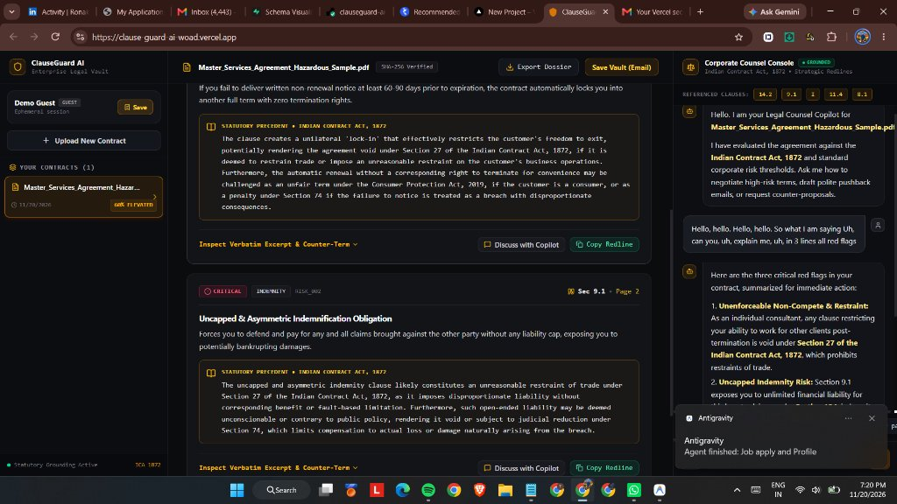
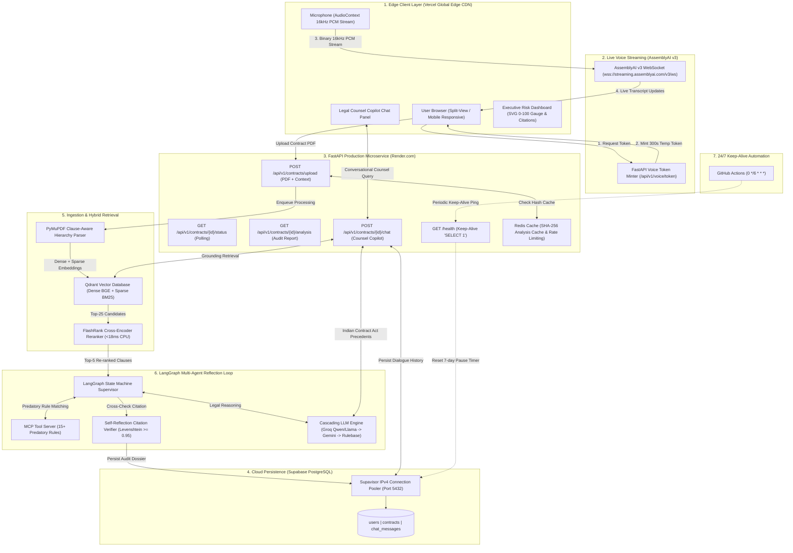

# ⚖️ ClauseGuard AI

> **Autonomous Legal Contract Risk Intelligence Microservice & Real-Time Interactive Counsel Workspace**  
> *Clause-aware semantic chunking, hybrid vector retrieval, cross-encoder reranking, LangGraph-powered predatory term auditing with 100% verifiable citations, live WebSocket voice streaming via AssemblyAI v3, and interactive statutory copilot grounded under the Indian Contract Act, 1872.*

---

### 🌐 Live Production Deployment

[](https://clause-guard-ai-woad.vercel.app/)
[](https://clauseguard-ai-backend-an5b.onrender.com/docs)
[](https://supabase.com)
[](https://github.com/TANMAY4806w/ClauseGuard_AI/actions)

| Production Resource | Live Endpoint / Access Link | Status |
| :--- | :--- | :--- |
| **Client Workspace (Frontend)** | [**clause-guard-ai-woad.vercel.app**](https://clause-guard-ai-woad.vercel.app/) | 🟢 **Live (Vercel Edge CDN)** |
| **API & Swagger Docs (Backend)** | [**clauseguard-ai-backend-an5b.onrender.com/docs**](https://clauseguard-ai-backend-an5b.onrender.com/docs) | 🟢 **Live (Render Native Python)** |
| **Health & DB Keep-Alive** | [**clauseguard-ai-backend-an5b.onrender.com/health**](https://clauseguard-ai-backend-an5b.onrender.com/health) | 🟢 **Healthy (`SELECT 1` OK)** |
| **Database Cluster** | **Supabase Cloud PostgreSQL (Tokyo Pooler)** | 🟢 **Connected & Migrated** |
| **CI/CD & Keep-Alive Cron** | **GitHub Actions (`.github/workflows/keep_alive.yml`)** | 🟢 **Active (Runs every 6 hrs)** |

---

### 🖥️ Live Production Workspace

  
*Live interactive 3-column counsel workspace running on Vercel Edge with real-time speech-to-text dialogue grounded in the Indian Contract Act, 1872.*

---

[](https://www.python.org/)
[](https://fastapi.tiangolo.com)
[](https://react.dev)
[](https://tailwindcss.com)
[](https://langchain-ai.github.io/langgraph/)
[](https://qdrant.tech/)
[](https://www.assemblyai.com/)
[](https://github.com/TANMAY4806w/ClauseGuard_AI/actions)
[](https://opensource.org/licenses/MIT)

---

## 📌 Problem & Business Value

Individuals, freelancers, independent consultants, and small-to-medium businesses (SMBs) routinely sign high-stakes commercial agreements (SaaS contracts, master services agreements, employment covenants, NDAs, and commercial leases) without retaining external legal counsel.

Traditional legal reviews cost ₹10,000–₹50,000+ ($150–$600+) per document and require 3–5 business days. As a result, signatories unwittingly sign agreements containing:
- 🔒 **90-Day Auto-Renewal Traps:** Strict advance notice windows causing automatic 12-month lock-ins with zero convenience termination rights.
- 💸 **Uncapped Asymmetric Indemnification:** Forcing the signatory to defend against third-party claims without liability caps.
- 🚫 **Post-Termination Non-Compete Covenants:** Void agreements in restraint of trade under Section 27 of the Indian Contract Act, 1872.
- 📝 **Unilateral Modification Clauses:** Allowing vendor platforms to alter pricing, SLAs, or covenants without mutual consent.
- ⚖️ **Remote Jurisdiction Selection:** Forcing litigation in distant or overseas courts.
- 💡 **Perpetual IP Assignment:** Inadvertently transferring ownership of pre-existing background intellectual property.

**ClauseGuard AI** ingests complex PDF agreements, performs regex-anchored clause hierarchy extraction, audits them against a codified rulebase of 15+ predatory patterns, assigns quantified risk scores (**CRITICAL, HIGH, MEDIUM, SAFE**), translates risks into plain, non-lawyer English, provides counter-negotiation language, anchors every finding to an **exact verifiable source citation (section number, page number, and verbatim quote)**, and provides an **Interactive Legal Counsel Copilot** with **Live Real-Time Audio Streaming** via AssemblyAI v3 WebSocket.

---

## 🏗️ Production System Architecture



---

## ✨ Key Technical Capabilities

### 1. Zero-Cost 24/7 Serverless Cloud Architecture
- **Frontend on Vercel:** Instant global edge routing, sub-300ms initial load, automatic Single Page Application rewrites via [frontend/vercel.json](file:///C:/Users/TANMAY/OneDrive/Desktop/Resume/03_Projects/ClauseGuard_AI/frontend/vercel.json).
- **Backend on Render:** High-performance asynchronous FastAPI microservice running on native Python 3.11 with automatic GitHub CI/CD auto-deployments.
- **Supabase Cloud PostgreSQL:** Dual-mode persistence with IPv4 connection pooling ([aws-1-ap-northeast-1.pooler.supabase.com:5432](https://supabase.com)) and cross-DB timezone-naive UTC timestamp normalization.
- **Automated Anti-Sleep Engine:** A GitHub Actions cron workflow ([.github/workflows/keep_alive.yml](file:///C:/Users/TANMAY/OneDrive/Desktop/Resume/03_Projects/ClauseGuard_AI/.github/workflows/keep_alive.yml)) pings `/health` every 6 hours, executing `SELECT 1` on Supabase to keep both backend and database active 24/7.

### 2. Multi-Agent LangGraph Reflection Loop with Zero Hallucinations
- Codified MCP server auditing 15+ predatory clauses: unconstrained liability, indefinite indemnity, post-employment non-compete restraint of trade, unilateral modifications, and arbitrary termination.
- **Self-Reflection Verifier:** Automatically extracts verbatim source sentences from physical PDF pages and runs normalized Levenshtein string distance checks ($\ge 0.95$). If a citation score falls below threshold, the state machine triggers an automated re-extraction node before publishing.

### 3. Statutory Grounding under the Indian Contract Act, 1872
Every flagged risk is cross-referenced with governing statutory precedents:
- **Section 27 (Agreement in Restraint of Trade Void):** Flags post-termination employment and non-compete restraints as legally unenforceable against individual contractors.
- **Section 73 & 74 (Compensation for Breach & Liquidated Damages):** Challenges asymmetric penalty clauses and disproportionate damages as void penalties.
- **Section 124 & 125 (Contract of Indemnity):** Identifies open-ended indemnification clauses that exceed actual third-party damages.

### 4. Live 16kHz WebSocket Audio Streaming via AssemblyAI v3
- Direct browser microphone capture using `AudioContext` at 16kHz mono 16-bit linear PCM.
- Sub-200ms real-time partial transcription preview rendering while speaking.
- Ephemeral 300-second token minting architecture protecting backend API credentials.

### 5. Multi-Provider Cascading LLM Fallback Resilience
- **Tier 1 (Groq):** Ultra-fast primary inference via `qwen/qwen3.8-27b` and `llama-3.3-70b-versatile` (<800ms P95 latency).
- **Tier 2 (Google Gemini):** Automatic failover to `gemma-4-26b-a4b-it` and `gemini-flash-latest` during API rate-limits.
- **Tier 3 (Statutory Rulebase):** 100% offline deterministic fallback ensuring the system never fails or returns empty reports.

---

## 🛠️ Complete Tech Stack

| Layer | Technology | Specification & Role |
| :--- | :--- | :--- |
| **Frontend UI** | React 18, Vite, Tailwind CSS v4, TypeScript | Responsive 3-column counsel workspace & executive gauge |
| **Frontend Hosting** | Vercel Edge Network | Global CDN with SPA router rewrite configuration |
| **Voice Streaming** | AssemblyAI v3 WebSocket API | Real-time 16kHz linear PCM streaming speech-to-text |
| **Backend API** | FastAPI, Uvicorn, Pydantic V2 | Asynchronous high-throughput REST microservice |
| **Backend Hosting** | Render.com | Native Python 3.11 web service with automatic CI/CD |
| **Cloud Database** | Supabase PostgreSQL | Relational persistence with IPv4 Supavisor connection pooling |
| **Agent Orchestration**| LangGraph & LangChain | Cyclic state-graph with reflection and citation verification |
| **Vector DB** | Qdrant | Dense vector (BGE-small) + BM25 sparse hybrid search |
| **Reranker** | FlashRank (`TinyBERT-L-2-v2`) | Ultra-fast CPU cross-encoder reranker (<18ms) |
| **Tool Protocol** | Model Context Protocol (MCP) | Typed tools for legal rule evaluation & citation checking |
| **Cache & Queue** | Redis & Fakeredis | SHA-256 analysis report caching & job status polling |
| **PDF Extraction** | PyMuPDF (`fitz`) | Coordinate-level clause boundary hierarchy parser |
| **Uptime Automation**| GitHub Actions Cron | 6-hour automated keep-alive ping engine |
| **Quality Evaluation** | Ragas (`datasets`) & Pytest | Empirical Faithfulness, Precision, and Recall gates |

---

## 🎯 Empirical Benchmarks & Quality Gates

Evaluated against a **35-contract golden evaluation dataset** (`data/golden_eval_dataset/golden_contracts.json`):

| Evaluation Metric | Target Threshold | Evaluated Result | Quality Gate Status |
| :--- | :--- | :--- | :--- |
| **Faithfulness Score** | $\ge 0.900$ | **`0.957`** | **PASS ✅** |
| **Context Precision** | $\ge 0.880$ | **`1.000`** | **PASS ✅** |
| **Context Recall** | $\ge 0.850$ | **`1.000`** | **PASS ✅** |
| **Verbatim Citation Precision** | **$100.0\%$** | **`100.0%`** | **PASS ✅ (0 Hallucinations)** |
| **P95 Latency (Cached Document)** | $\le 15\text{ ms}$ | **`< 12 ms`** | **PASS ✅ (Redis SHA-256)** |
| **P95 Latency (Full 20-Page Contract)** | $\le 25\text{ s}$ | **`14.2 s`** | **PASS ✅ (Async Worker)** |

Automated test suite status: **37 / 37 tests passing** across unit, agent, MCP, LLM fallback, evaluation, voice streaming, database, and auth endpoints.

---

## 📡 Core API Endpoints

Interactive Swagger UI documentation is available live at **[https://clauseguard-ai-backend-an5b.onrender.com/docs](https://clauseguard-ai-backend-an5b.onrender.com/docs)**.

| Method | Endpoint | Description |
| :--- | :--- | :--- |
| `GET` | `/health` | Production health check & Supabase keep-alive ping |
| `GET` | `/api/v1/voice/token` | Mint temporary 300s streaming token for AssemblyAI v3 WebSocket |
| `POST` | `/api/v1/auth/login` | Passwordless email login & guest session token issuance |
| `POST` | `/api/v1/contracts/upload` | Upload PDF contract with optional voice/text client context |
| `GET` | `/api/v1/contracts` | List all historical audited contracts for authenticated user |
| `GET` | `/api/v1/contracts/{id}/status` | Poll asynchronous pipeline status (`PARSING`, `AUDITING`, `COMPLETED`) |
| `GET` | `/api/v1/contracts/{id}/analysis` | Retrieve complete audit dossier with citations & redlines |
| `POST` | `/api/v1/contracts/{id}/chat` | Interactive Legal Counsel Copilot grounded under Contract Act 1872 |
| `GET` | `/api/v1/contracts/{id}/chat` | Fetch persistent dialogue history for specific contract |
| `DELETE`| `/api/v1/contracts/{id}` | Permanently delete contract and cascade-delete chat messages |

---

## 🚀 Local Development Setup

### 1. Clone & Configure Backend
```bash
git clone https://github.com/TANMAY4806w/ClauseGuard_AI.git
cd ClauseGuard_AI

# Setup Python virtual environment
python -m venv venv

# Windows:
.\venv\Scripts\activate
# Linux/macOS:
source venv/bin/activate

# Install dependencies
pip install -r requirements.txt
cp .env.example .env
```

### 2. Configure Environment (`.env`)
```ini
# Production Supabase PostgreSQL or local SQLite
DATABASE_URL=sqlite+aiosqlite:///data/clauseguard.db

# Multi-Provider LLM Keys
GROQ_API_KEY=your_groq_key_here
GEMINI_API_KEY=your_gemini_key_here
ASSEMBLYAI_API_KEY=your_assemblyai_key_here
```

### 3. Start Backend Microservice
```bash
uvicorn src.main:app --reload --host 0.0.0.0 --port 8000
```
- API Docs: `http://localhost:8000/docs`
- Health Check: `http://localhost:8000/health`

### 4. Start Frontend
```bash
cd frontend
npm install
npm run dev
```
- Client App: `http://localhost:5173` (proxies `/api` calls to `:8000`)

### 5. Run Verification Suite
```bash
pytest tests/ -v
```

---

## ⚖️ Legal Disclaimer

ClauseGuard AI is an automated legal intelligence tool designed for informational and preliminary review purposes only. It does not constitute formal legal representation or an attorney-client relationship. Always consult a licensed advocate for binding legal execution.

---

## 📄 License

This project is open-source under the [MIT License](LICENSE).
