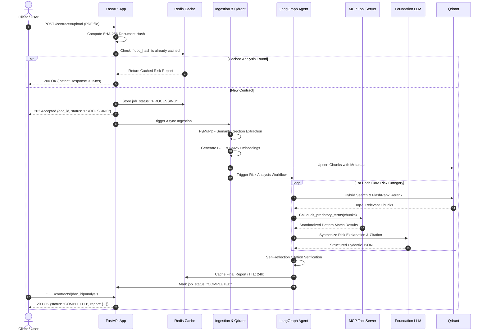

# System Architecture & Data Flow Specification

---

## 1. High-Level System Architecture

ClauseGuard AI is engineered as a decoupled, multi-container microservice system designed for high reliability, deterministic execution, and low inference latency.

```mermaid
flowchart TD
    subgraph ClientLayer["1. Client Layer (React 18 + Vite + Tailwind CSS v4)"]
        Browser["User Browser (Split / Tabbed)"]
        Mic["Microphone (AudioContext 16kHz PCM Stream)"]
        CopilotUI["Legal Counsel Copilot Chat Panel"]
        AuditUI["Executive Risk Dashboard (SVG 0-100 Gauge)"]
    end

    subgraph StreamingLayer["2. Live Voice Streaming (AssemblyAI v3)"]
        TokenAPI["FastAPI Voice Token Minter (/api/v1/voice/token)"]
        AssemblyWS["AssemblyAI v3 WebSocket (wss://streaming.assemblyai.com/v3/ws)"]
    end

    subgraph BackendGateway["3. FastAPI Gateway (Port 8000)"]
        UploadAPI["POST /api/v1/contracts/upload (PDF + Context)"]
        StatusAPI["GET /api/v1/contracts/{id}/status (Polling)"]
        AnalysisAPI["GET /api/v1/contracts/{id}/analysis (Audit Report)"]
        ChatAPI["POST /api/v1/contracts/{id}/chat (Counsel Copilot)"]
        RedisCache["Redis Cache & State Store"]
    end

    subgraph ProcessingPipeline["4. Ingestion & Vector Retrieval"]
        PyMuPDF["PyMuPDF Clause Parser"]
        Qdrant["Qdrant Vector DB (Dense BGE + Sparse BM25)"]
        FlashRank["FlashRank Cross-Encoder (<18ms)"]
    end

    subgraph AgenticLayer["5. LangGraph & Multi-Provider LLM Fallback"]
        Supervisor["LangGraph Supervisor Agent"]
        MCPServer["MCP Tool Server (15+ Predatory Rules)"]
        Reflection["Self-Reflection Citation Verifier"]
        LLM["Multi-Provider LLM (Groq -> Gemini -> OpenRouter -> Rulebase)"]
    end

    Mic -->|Request Token| TokenAPI
    TokenAPI -->|Return 300s Temp Token| Mic
    Mic -->|Binary 16kHz PCM Audio Stream| AssemblyWS
    AssemblyWS -->|Real-Time Text Transcripts| Browser

    Browser -->|Upload PDF + Context| UploadAPI
    UploadAPI --> PyMuPDF
    PyMuPDF --> Qdrant
    Qdrant --> FlashRank
    FlashRank --> Supervisor
    Supervisor <--> MCPServer
    Supervisor <--> LLM
    Supervisor --> Reflection
    Reflection --> RedisCache
    Browser <--> AnalysisAPI

    CopilotUI -->|Ask Question / Advice| ChatAPI
    ChatAPI <--> Qdrant
    ChatAPI <--> LLM
    ChatAPI --> CopilotUI
```



---

## 2. Ingestion Pipeline & Clause-Aware Chunking

### 2.1 The Chunking Challenge in Legal Tech
Standard naive text splitters (e.g., splitting every 500 characters or 200 tokens with 20-token overlap) catastrophically break legal documents. An indemnity clause or cancellation condition that begins at token 180 and ends at token 320 will get sliced across chunks, losing its legal context and distorting cross-references.

### 2.2 Semantic Clause Parser Specification (`src/ingestion/chunker.py`)
ClauseGuard AI uses a **regex-anchored semantic hierarchy splitter**:
1. **Header & Section Extraction:** Detects standardized numbering formats:
   * Roman numerals: `Article I`, `Article II`, etc.
   * Decimal numbering: `1.0`, `1.1`, `1.1.1`, `Section 4(b)`.
   * Bold legal caps: `TERMINATION`, `INDEMNITY`, `GOVERNING LAW`, `CONFIDENTIALITY`.
2. **Page & Coordinate Tracking:** For each extracted clause, PyMuPDF captures:
   * `page_number` (1-indexed physical PDF page).
   * `section_title` (e.g., "Section 8.2 - Automatic Renewal").
   * `bounding_box` coordinates (optional visual highlight coordinates).
   * `verbatim_text` (exact clean string).
3. **Payload Construction:** Every chunk ingested into Qdrant adheres to this metadata schema:
   ```json
   {
     "doc_id": "doc_9a7b2c3d",
     "clause_id": "clause_014",
     "section_number": "8.2",
     "section_title": "Renewal Term and Notice of Cancellation",
     "page_number": 6,
     "character_count": 482,
     "token_count": 112,
     "raw_text": "Unless Customer provides written notice of non-renewal at least ninety (90) days prior to the expiration of the Initial Term..."
   }
   ```

---

## 3. Hybrid Retrieval & Cross-Encoder Reranking

### 3.1 Why Hybrid Search (Dense + Sparse)?
* **Dense Vectors (`BAAI/bge-small-en-v1.5`):** Excels at conceptual semantics (e.g., matching *"who pays if someone sues us"* to an *"Indemnification"* clause).
* **Sparse Search (`BM25`):** Excels at exact numeric and legal identifier matches (e.g., *"90 days"*, *"₹50,000"*, *"triple damages"*, *"delaware"*).
* Combining both via Reciprocal Rank Fusion (RRF) in Qdrant ensures that neither legal concepts nor exact contractual numbers are missed.

### 3.2 FlashRank Cross-Encoder Pipeline (`src/vectorstore/reranker.py`)
1. Qdrant retrieves the top 25 candidate chunks via hybrid search.
2. A lightweight, CPU-optimized cross-encoder model (`ms-marco-TinyBERT-L-2-v2` via `FlashRank`) scores the direct relevance between the audit query and candidate text.
3. The top 5 highest-confidence chunks are forwarded to the agent's context window.
4. **Latency Benefit:** FlashRank executes in $< 18 \text{ ms}$ on CPU, cutting token overhead by $70\%$ before invoking the LLM.

---

## 4. End-to-End Execution Sequence



---

## 5. Live Production Cloud Topology & Zero-Cost Serverless Deployment

In live production, ClauseGuard AI runs across a decoupled, zero-cost cloud architecture:

| Component | Provider & URL | Infrastructure Specification |
| :--- | :--- | :--- |
| **Frontend SPA** | [Vercel](https://clause-guard-ai-woad.vercel.app/) | Global Edge CDN, sub-300ms initial load, automatic SPA rewrites |
| **Backend API** | [Render](https://clauseguard-ai-backend-an5b.onrender.com) | Python 3.11 asynchronous web service running Uvicorn + FastAPI |
| **Database** | [Supabase](https://supabase.com) | PostgreSQL cloud cluster with Supavisor IPv4 session pooling (Port 5432) |
| **Voice STT** | AssemblyAI v3 | Real-time WebSocket streaming (`wss://streaming.assemblyai.com/v3/ws`) |
| **Keep-Alive Engine**| GitHub Actions | Automated 6-hour cron (`keep_alive.yml`) pinging `/health` to maintain 100% uptime |
