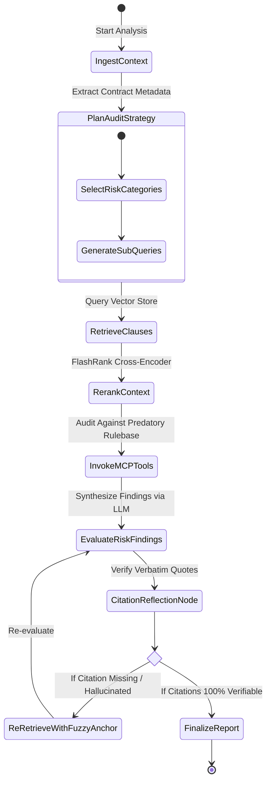

# Agentic Workflow & Model Context Protocol (MCP) Specification

---

## 1. LangGraph State Machine Architecture

The risk audit engine is modeled as a cyclic state machine built with **LangGraph** (`StateGraph`). It guarantees deterministic progression, structured tool invocation, and an automated **self-reflection verification loop**.



### 1.1 State Schema Definition (`src/agent/state.py`)
```python
from typing import List, Dict, Any, Optional
from typing_extensions import TypedDict
from pydantic import BaseModel, Field

class ClauseCitation(BaseModel):
    section_number: str
    page_number: int
    verbatim_quote: str

class FlaggedRisk(BaseModel):
    risk_id: str
    category: str  # e.g., "Termination", "Indemnity", "Liability"
    risk_level: str  # "HIGH", "MEDIUM", "LOW"
    headline: str
    plain_english_explanation: str
    recommended_counter_term: str
    citation: ClauseCitation
    confidence_score: float

class ClauseGuardState(TypedDict):
    doc_id: str
    contract_title: str
    total_pages: int
    target_risk_categories: List[str]
    retrieved_chunks: List[Dict[str, Any]]
    preliminary_risks: List[FlaggedRisk]
    verification_errors: List[str]
    reflection_attempts: int
    final_risk_score: float
    final_report: Optional[Dict[str, Any]]
```

---

## 2. Model Context Protocol (MCP) Server Specification

ClauseGuard AI exposes its analytical tools through a standardized **Model Context Protocol (MCP)** server. This ensures that the reasoning agent interacts with internal databases and legal rulebases strictly through defined, typed contracts.

### 2.1 Tool 1: `query_contract_vector_store`
* **Purpose:** Queries Qdrant using hybrid retrieval (Dense + BM25) and returns top-k chunks.
* **Input Schema:**
  ```json
  {
    "type": "object",
    "properties": {
      "doc_id": { "type": "string" },
      "query": { "type": "string", "description": "Semantic query describing legal scenario" },
      "category_filter": { "type": "string", "enum": ["ANY", "TERMINATION", "INDEMNITY", "LIABILITY", "JURISDICTION", "IP"] },
      "limit": { "type": "integer", "default": 5 }
    },
    "required": ["doc_id", "query"]
  }
  ```

### 2.2 Tool 2: `audit_predatory_terms`
* **Purpose:** Executes pattern-matching logic against our curated legal rulebase of 15+ predatory clauses.
* **Curated Pattern Catalog:**
  1. `AUTO_RENEWAL_90D`: Automatic renewal with notification window $\ge 60$ days.
  2. `UNLIMITED_INDEMNIFICATION`: Signatory indemnifies counterparty without dollar cap.
  3. `UNILATERAL_PRICE_MODIFICATION`: Right to alter fees/terms without mutual amendment.
  4. `BROAD_NON_COMPETE`: Post-termination non-compete extending beyond 12 months or broad geography.
  5. `ASMETRIC_ATTORNEY_FEES`: Only one party recovers legal fees upon dispute.
  6. `LIQUIDATED_DAMAGES_PENALTY`: Excessive fixed forfeiture unlinked to actual loss.
  7. `REMOTE_JURISDICTION_SELECTION`: Choice of law/venue outside customer domicile.
  8. `PERPETUAL_IP_ASSIGNMENT`: IP transfer without full fee payment milestone.

### 2.3 Tool 3: `verify_source_citation` (Self-Reflection Guardrail)
* **Purpose:** Eliminates LLM hallucination by performing deterministic substring and fuzzy string alignment.
* **Validation Logic:**
  * Checks if `verbatim_quote` exists character-for-character within the specified `page_number` in raw document memory.
  * If Levenshtein similarity $< 0.95$, the quote is flagged as **HALLUCINATED**, triggering the reflection node to re-extract or correct the citation coordinates.

### 2.4 Tool 4: `synthesize_plain_english_advice`
* **Purpose:** Uses structured formatting to produce customer-facing advice and non-lawyer negotiation counter-proposals.

---

## 3. Strict Pydantic Output Schemas (`src/api/schemas.py`)

The final output is guaranteed to be compliant with the following Pydantic V2 model:

```python
from enum import Enum
from typing import List
from pydantic import BaseModel, Field

class RiskLevelEnum(str, Enum):
    CRITICAL = "CRITICAL"
    HIGH = "HIGH"
    MEDIUM = "MEDIUM"
    LOW = "LOW"
    SAFE = "SAFE"

class CitationModel(BaseModel):
    section: str = Field(..., description="e.g. Section 14.3(b)")
    page: int = Field(..., description="Physical page number in PDF")
    verbatim_text: str = Field(..., description="Exact quoted text from contract")

class ClauseAuditItem(BaseModel):
    risk_id: str
    clause_category: str
    risk_level: RiskLevelEnum
    headline: str
    danger_summary: str = Field(..., description="Plain-English explanation of why this clause hurts the user")
    recommended_counter_term: str = Field(..., description="Negotiation script/clause to suggest instead")
    citation: CitationModel

class ContractAnalysisResponse(BaseModel):
    doc_id: str
    contract_name: str
    overall_contract_risk_score: float = Field(..., ge=0.0, le=100.0, description="0 (Completely Safe) to 100 (Extremely Hazardous)")
    total_clauses_analyzed: int
    flagged_risks_count: int
    risk_summary_breakdown: dict  # {"CRITICAL": 1, "HIGH": 3, "MEDIUM": 2, "LOW": 0}
    findings: List[ClauseAuditItem]
    audit_timestamp: str
```
