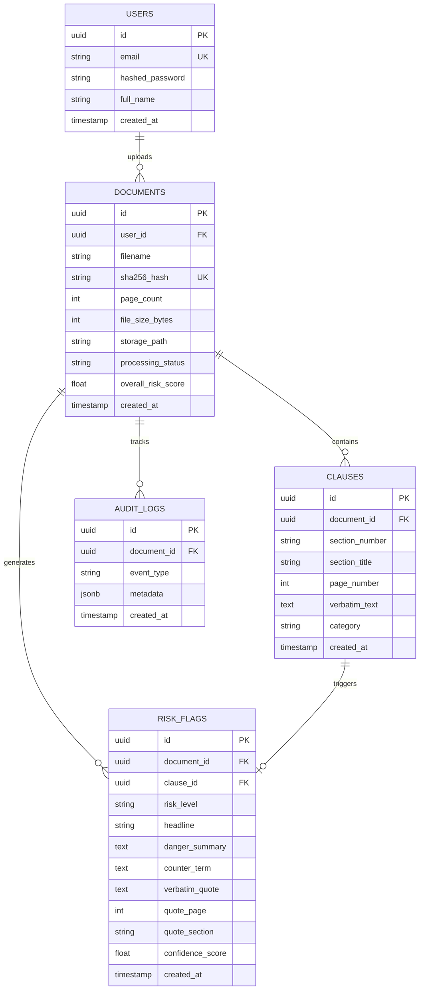

# Database & API Design Specification

---

## 1. PostgreSQL Relational Database Schema

ClauseGuard AI uses **PostgreSQL** as its persistent transactional database for user accounts, document metadata, clause chunks, and audit logs.



### 1.1 PostgreSQL DDL Schema (`migrations/init.sql`)
```sql
CREATE EXTENSION IF NOT EXISTS "uuid-ossp";

CREATE TABLE users (
    id UUID PRIMARY KEY DEFAULT uuid_generate_v4(),
    email VARCHAR(255) UNIQUE NOT NULL,
    hashed_password VARCHAR(255) NOT NULL,
    full_name VARCHAR(255),
    created_at TIMESTAMP WITH TIME ZONE DEFAULT CURRENT_TIMESTAMP
);

CREATE TABLE documents (
    id UUID PRIMARY KEY DEFAULT uuid_generate_v4(),
    user_id UUID REFERENCES users(id) ON DELETE CASCADE,
    filename VARCHAR(255) NOT NULL,
    sha256_hash VARCHAR(64) UNIQUE NOT NULL,
    page_count INTEGER NOT NULL,
    file_size_bytes INTEGER NOT NULL,
    storage_path VARCHAR(512) NOT NULL,
    processing_status VARCHAR(50) DEFAULT 'PENDING',
    overall_risk_score NUMERIC(5,2),
    created_at TIMESTAMP WITH TIME ZONE DEFAULT CURRENT_TIMESTAMP
);

CREATE TABLE clauses (
    id UUID PRIMARY KEY DEFAULT uuid_generate_v4(),
    document_id UUID REFERENCES documents(id) ON DELETE CASCADE,
    section_number VARCHAR(50),
    section_title VARCHAR(255),
    page_number INTEGER NOT NULL,
    verbatim_text TEXT NOT NULL,
    category VARCHAR(50),
    created_at TIMESTAMP WITH TIME ZONE DEFAULT CURRENT_TIMESTAMP
);

CREATE TABLE risk_flags (
    id UUID PRIMARY KEY DEFAULT uuid_generate_v4(),
    document_id UUID REFERENCES documents(id) ON DELETE CASCADE,
    clause_id UUID REFERENCES clauses(id) ON DELETE SET NULL,
    risk_level VARCHAR(20) NOT NULL,
    headline VARCHAR(255) NOT NULL,
    danger_summary TEXT NOT NULL,
    counter_term TEXT NOT NULL,
    verbatim_quote TEXT NOT NULL,
    quote_page INTEGER NOT NULL,
    quote_section VARCHAR(50),
    confidence_score NUMERIC(4,3),
    created_at TIMESTAMP WITH TIME ZONE DEFAULT CURRENT_TIMESTAMP
);
```

---

## 2. Redis Caching & Queue Architecture

Redis acts as our in-memory acceleration layer to ensure sub-15ms response times on repeated queries and to manage job statuses.

| Redis Key Pattern | Type | TTL | Purpose |
| :--- | :--- | :--- | :--- |
| `contract:hash:{sha256}` | String (JSON) | 86,400s (24h) | Stores the complete finalized `ContractAnalysisResponse`. If an identical PDF is uploaded, returns cached result in $< 10\text{ ms}$. |
| `job:status:{doc_id}` | String | 3,600s (1h) | Tracks async job lifecycle: `PENDING`, `PARSING`, `EMBEDDING`, `AUDITING`, `COMPLETED`, `FAILED`. |
| `ratelimit:{user_id}:{minute}` | Integer | 60s | Token bucket enforcing maximum 20 uploads/minute per user. |

---

## 3. FastAPI REST Endpoints Contract

All endpoints run on Python 3.11+ using asynchronous `async def` route handlers.

### 3.1 `POST /api/v1/auth/token`
* **Description:** Exchange username/password for a signed JWT access token.
* **Request:** `OAuth2PasswordRequestForm` (`username`, `password`)
* **Response (200 OK):**
  ```json
  {
    "access_token": "eyJhbGciOiJIUzI1Ni...",
    "token_type": "bearer",
    "expires_in": 86400
  }
  ```

### 3.2 `POST /api/v1/contracts/upload`
* **Description:** Uploads a contract file for asynchronous audit analysis.
* **Security:** `Bearer <JWT>`
* **Content-Type:** `multipart/form-data`
* **Body:** `file: UploadFile` (PDF format, max 25MB)
* **Response (202 Accepted):**
  ```json
  {
    "doc_id": "9a7b2c3d-e4f5-4a6b-8c7d-0e1f2a3b4c5d",
    "filename": "Vendor_Master_Service_Agreement_2026.pdf",
    "sha256_hash": "e3b0c44298fc1c149afbf4c8996fb92427ae41e4649b934ca495991b7852b855",
    "status": "PROCESSING",
    "estimated_seconds": 15,
    "check_status_url": "/api/v1/contracts/9a7b2c3d-e4f5-4a6b-8c7d-0e1f2a3b4c5d/status"
  }
  ```

### 3.3 `GET /api/v1/contracts/{doc_id}/status`
* **Description:** Polls the real-time processing stage of an ongoing analysis.
* **Response (200 OK):**
  ```json
  {
    "doc_id": "9a7b2c3d-e4f5-4a6b-8c7d-0e1f2a3b4c5d",
    "current_stage": "AUDITING_PREDATORY_TERMS",
    "progress_percent": 75,
    "is_completed": false
  }
  ```

### 3.4 `GET /api/v1/contracts/{doc_id}/analysis`
* **Description:** Retrieves the completed risk intelligence report.
* **Response (200 OK):** (Matches `ContractAnalysisResponse` Pydantic model)
  ```json
  {
    "doc_id": "9a7b2c3d-e4f5-4a6b-8c7d-0e1f2a3b4c5d",
    "contract_name": "Vendor_Master_Service_Agreement_2026.pdf",
    "overall_contract_risk_score": 78.5,
    "total_clauses_analyzed": 42,
    "flagged_risks_count": 3,
    "risk_summary_breakdown": {
      "CRITICAL": 1,
      "HIGH": 2,
      "MEDIUM": 0,
      "LOW": 0
    },
    "findings": [
      {
        "risk_id": "RISK_001",
        "clause_category": "Termination & Auto-Renewal",
        "risk_level": "CRITICAL",
        "headline": "Strict 90-Day Advance Auto-Renewal Lock-in",
        "danger_summary": "If you fail to send written non-renewal notice exactly 90 days before the contract anniversary, you are locked into another 12 months with no option to exit.",
        "recommended_counter_term": "Replace with 30-day notice and allow prorated termination for convenience.",
        "citation": {
          "section": "Section 14.2",
          "page": 9,
          "verbatim_text": "Unless Customer provides written notice of non-renewal at least ninety (90) days prior to the expiration of the Initial Term, this Agreement shall automatically renew for successive twelve (12) month periods."
        }
      }
    ],
    "audit_timestamp": "2026-11-13T22:30:00Z"
  }
  ```
