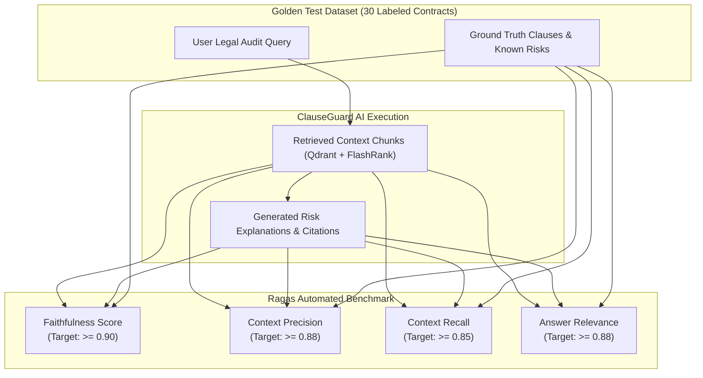

# Evaluation & Quality Assurance Specification (Ragas Framework)

---

## 1. Why Quantitative Evaluation Is Mandatory

In production legal AI, claiming *"the model looks accurate"* is insufficient. Legal risk analysis has zero tolerance for hallucinations. 

ClauseGuard AI incorporates the **Ragas (Retrieval Augmented Generation Assessment)** framework to mathematically benchmark the quality of its retrieval and generation pipelines.



---

## 2. Ragas Metrics Breakdown & Mathematical Definitions

### 2.1 Faithfulness (Anti-Hallucination Metric)
* **What it measures:** The factual consistency of the generated risk explanation against the retrieved contract text.
* **Formula:**
  $$\text{Faithfulness} = \frac{|\text{Number of claims in explanation supported by contract context}|}{|\text{Total number of claims made in explanation}|}$$
* **ClauseGuard Threshold:** **$\ge 0.92$** (Any score below 0.90 indicates hallucinated risks and fails the CI test).

### 2.2 Context Precision
* **What it measures:** Whether all the ground-truth relevant clauses were ranked at the very top of the retrieved context chunks by Qdrant and FlashRank.
* **ClauseGuard Threshold:** **$\ge 0.88$**.

### 2.3 Context Recall
* **What it measures:** The extent to which the retrieved context contains all clauses necessary to detect the known predatory risk.
* **ClauseGuard Threshold:** **$\ge 0.85$**.

### 2.4 Verbatim Citation Precision (Deterministic Check)
* **What it measures:** A strict binary check $(0 \text{ or } 1)$ verifying that the `verbatim_text` field exists verbatim on the specified `page_number` in the source PDF.
* **ClauseGuard Threshold:** **$100\%$** (Zero tolerance for distorted citations).

---

## 3. Golden Evaluation Dataset Construction (`data/golden_eval_dataset/`)

The evaluation dataset consists of **35 curated and labeled real-world contract excerpts** sourced from public repositories (SEC EDGAR filings, public open rental templates, and standard SaaS vendor agreements):

```json
[
  {
    "id": "eval_001",
    "contract_type": "Commercial SaaS Agreement",
    "query": "Does the vendor have the right to unilaterally alter subscription pricing or service terms?",
    "ground_truth_context": "Vendor reserves the right, in its sole discretion, to modify, update, or discontinue the Services or change prices at any time upon posting notice on its website.",
    "ground_truth_section": "Section 11.4",
    "ground_truth_page": 14,
    "expected_risk_level": "CRITICAL",
    "expected_headline": "Unilateral Price and Service Modification"
  },
  {
    "id": "eval_002",
    "contract_type": "Residential Lease Agreement",
    "query": "What is the advance notice requirement to prevent automatic lease renewal?",
    "ground_truth_context": "Tenant must deliver written notice via certified mail ninety (90) days prior to the expiration of the Lease. Failure to do so automatically renews the lease for a subsequent twelve (12) month term.",
    "ground_truth_section": "Clause 22(b)",
    "ground_truth_page": 5,
    "expected_risk_level": "HIGH",
    "expected_headline": "90-Day Advance Notice Auto-Renewal Lock-in"
  }
]
```

---

## 4. Automated Benchmark Execution Script (`evaluation/run_ragas_eval.py`)

```python
import asyncio
from datasets import Dataset
from ragas import evaluate
from ragas.metrics import (
    faithfulness,
    context_precision,
    context_recall,
    answer_relevance,
)

async def run_evaluation():
    # 1. Load golden test set
    golden_data = load_golden_dataset("data/golden_eval_dataset/golden_contracts.json")
    
    # 2. Run ClauseGuard AI pipeline over queries
    results = []
    for item in golden_data:
        response = await run_clauseguard_pipeline(item["query"], item["doc_path"])
        results.append({
            "question": item["query"],
            "contexts": [chunk["raw_text"] for chunk in response["retrieved_chunks"]],
            "answer": response["danger_summary"],
            "ground_truth": item["ground_truth_context"]
        })
        
    eval_dataset = Dataset.from_list(results)
    
    # 3. Compute Ragas scores
    score = evaluate(
        eval_dataset,
        metrics=[faithfulness, context_precision, context_recall, answer_relevance]
    )
    
    df = score.to_pandas()
    print("=== RAGAS EVALUATION REPORT ===")
    print(df.mean())
    
    # 4. Enforce Quality Gate in CI/CD
    assert score["faithfulness"] >= 0.90, f"Faithfulness score {score['faithfulness']} is below threshold 0.90"
    assert score["context_precision"] >= 0.88, f"Context Precision {score['context_precision']} is below threshold 0.88"
    print("ALL QUALITY GATES PASSED.")

if __name__ == "__main__":
    asyncio.run(run_evaluation())
```
