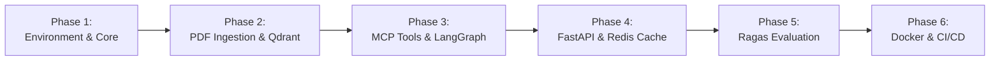

# Step-by-Step Implementation Roadmap for Builder Agent

---

## 1. Overview & Operating Mindset

This document provides the exact, sequential implementation plan for the engineer or autonomous agent building **ClauseGuard AI**. 

Follow the phases in order. **Never skip to the API or UI before the core ingestion and agentic tool layers are validated with unit tests.**

---

## 2. Phase-by-Phase Execution Checklist

### Phase 1: Environment Setup & Core Foundations
* [ ] **Task 1.1:** Initialize virtual environment (`python -m venv venv`) and activate it.
* [ ] **Task 1.2:** Install dependencies from `requirements.txt`.
* [ ] **Task 1.3:** Configure `.env` from `.env.example` with valid LLM API keys (`GEMINI_API_KEY` or `OPENROUTER_API_KEY`).
* [ ] **Task 1.4:** Implement `src/core/config.py` using `pydantic-settings` to parse environment variables with type validation.
* [ ] **Task 1.5:** Implement `src/core/logger.py` with structured JSON output formatting.

### Phase 2: Ingestion Pipeline & Hybrid Vector Store
* [ ] **Task 2.1:** Implement `src/ingestion/pdf_parser.py` using `PyMuPDF` (`fitz`) to extract raw text, physical page numbers, and bounding-box coordinates.
* [ ] **Task 2.2:** Implement `src/ingestion/chunker.py` with regex section anchors to split clauses cleanly by headers without breaking sentences.
* [ ] **Task 2.3:** Implement `src/vectorstore/qdrant_client.py` initializing the Qdrant collection with cosine distance and payload indexing on `doc_id` and `category`.
* [ ] **Task 2.4:** Implement `src/vectorstore/reranker.py` initializing `FlashRank` (`ms-marco-TinyBERT-L-2-v2`) for cross-encoder reranking.
* [ ] **Verification Gate 2:** Write `tests/test_ingestion.py`. Ingest a sample 5-page PDF; verify all chunks retain accurate page numbers and can be queried via hybrid search.

### Phase 3: Model Context Protocol (MCP) Server & LangGraph Agent
* [ ] **Task 3.1:** Implement `src/agent/mcp_server.py` exposing our 4 core tools:
  * `query_contract_vector_store`
  * `audit_predatory_terms` (contains the 15+ predatory rulebase patterns)
  * `verify_source_citation` (deterministic string/Levenshtein matching)
  * `synthesize_plain_english_advice`
* [ ] **Task 3.2:** Define the LangGraph state in `src/agent/state.py` (`ClauseGuardState`).
* [ ] **Task 3.3:** Build the graph nodes in `src/agent/graph.py`:
  * `plan_node`: Generates targeted sub-queries for each risk category.
  * `retrieve_and_rerank_node`: Calls Qdrant + FlashRank.
  * `audit_clause_node`: Invokes MCP tools and LLM structured generation.
  * `reflection_node`: Verifies citation accuracy. If hallucinated, routes back with a fuzzy search anchor.
* [ ] **Verification Gate 3:** Run `tests/test_agent.py`. Verify that the agent correctly detects an auto-renewal trap and returns a valid Pydantic JSON object with verifiable citations.

### Phase 4: FastAPI REST API & Redis Acceleration
* [ ] **Task 4.1:** Implement Pydantic V2 schemas in `src/api/schemas.py` (`ContractAnalysisResponse`, `ClauseAuditItem`).
* [ ] **Task 4.2:** Implement Redis caching service in `src/services/cache.py` (caching by document SHA-256 hash).
* [ ] **Task 4.3:** Implement asynchronous endpoints in `src/api/routes.py`:
  * `POST /api/v1/contracts/upload` (accepts PDF, enqueues background audit, returns `202 Accepted`).
  * `GET /api/v1/contracts/{doc_id}/status` (returns real-time progress).
  * `GET /api/v1/contracts/{doc_id}/analysis` (returns finalized report).
* [ ] **Verification Gate 4:** Launch the server (`uvicorn src.main:app --reload`); test the full upload and analysis flow through Swagger UI at `http://localhost:8000/docs`.

### Phase 5: Ragas Evaluation & Benchmarking
* [ ] **Task 5.1:** Place 30+ labeled ground-truth legal clauses in `data/golden_eval_dataset/`.
* [ ] **Task 5.2:** Implement `evaluation/run_ragas_eval.py` using the `ragas` library.
* [ ] **Task 5.3:** Run the benchmark and ensure metrics pass thresholds:
  * Faithfulness $\ge 0.90$
  * Context Precision $\ge 0.88$
  * Context Recall $\ge 0.85$
* [ ] **Task 5.4:** Export the evaluation results table and embed it into `README.md`.

### Phase 6: Multi-Container Docker Deployment & CI/CD
* [ ] **Task 6.1:** Write a production multi-stage `Dockerfile` (pinning Python 3.11-slim, non-root user).
* [ ] **Task 6.2:** Finalize `docker-compose.yml` orchestrating `api`, `qdrant`, and `redis`.
* [ ] **Task 6.3:** Write GitHub Actions workflow (`.github/workflows/ci.yml`) running `pytest` and linting on every push.
* [ ] **Verification Gate 6:** Run `docker-compose up --build`. Ensure all 3 containers communicate and pass integration healthchecks.

---

## 3. Common Failure Modes & Recovery Protocols

| Failure Mode | Root Cause | Engineering Solution |
| :--- | :--- | :--- |
| **PDF text is garbled / empty** | Scanned document or non-standard fonts. | PyMuPDF detects page text length $< 50$ chars; logs warning and applies OCR fallback. |
| **LLM returns unstructured text** | Free-form output bypass. | Force strict JSON schema via Pydantic output parser; fail fast and retry if JSON parsing errors occur. |
| **Citation quote not found in PDF** | LLM paraphrased instead of quoting verbatim. | The `reflection_node` catches Levenshtein mismatch, forces exact substring extraction from retrieved chunk payload. |
| **Slow response on long documents** | Synchronous HTTP blocking. | Handled via FastAPI `BackgroundTasks`; returns `202 Accepted` immediately with status polling endpoint. |
| **Qdrant payload serialization bug** | Storing complex Python objects directly in Qdrant payload. | Always call `.model_dump()` or convert metadata to primitive types (`str`, `int`, `float`, `dict`) before upserting. |

---

## 4. Definition of Done (DoD)
A feature or phase is considered complete **only when**:
1. All relevant unit tests pass with `pytest`.
2. Type hints are strictly enforced (no untyped `Any` in core contracts).
3. Code is formatted and linted.
4. The feature is verifiable end-to-end via Docker Compose.
