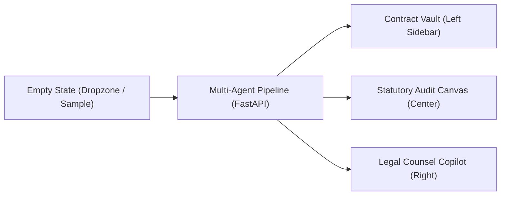

# ClauseGuard AI — Comprehensive UI/UX Audit & Production Remediation Plan

This audit documents every visual bug, layout defect, clipping issue, glyph glitch, and responsive shortcoming discovered across the ClauseGuard AI workspace during automated browser testing and code review.

---

## 1. Executive Summary of Audit Findings

| ID | Component / Area | Defect Description | Severity | Status |
|---|---|---|---|---|
| **BUG-01** | `ContractVaultSidebar.tsx` | Uncaught TypeError: `Cannot read properties of undefined (reading 'forEach')` on fresh load when `sessionContracts` prop was omitted. Crashed entire React component tree to blank black screen. | **P0 (Blocker)** | Fixed (`sessionContracts = []` default + optional prop) |
| **BUG-02** | `App.tsx` & `ContractVaultSidebar` | Ephemeral guest session contracts not persisted in sidebar. Loading sample or uploading contract left sidebar at `YOUR CONTRACTS (0)` and `No contracts in vault`. | **P0 (Functional)** | Fixed (`sessionContracts` state + `localStorage` cache) |
| **BUG-03** | `LegalCopilot.tsx` | Raw markdown asterisks displayed in chat bubbles (`**General Legal Consultation**`, `**Indian Contract Act, 1872**`) instead of formatted bold typography. | **P1 (Visual)** | Fixed (`renderMarkdownContent` inline parser) |
| **BUG-04** | `LegalCopilot.tsx` | Stale consultation title: Copilot header and greeting persisted "General Legal Consultation" even after analyzing a specific agreement (`Master_Services_Agreement_Hazardous_Sample.pdf`). | **P1 (Functional)** | Fixed (Dynamic document effect loader & greeting sync) |
| **BUG-05** | `RiskGauge.tsx` | Telemetry breakdown overlap: 5-column bento box squished `CRITICAL`, `HIGH`, `MEDIUM`, and `AUDIT RATIO` badges on medium screen widths, causing text overlap. | **P1 (Visual)** | Fixed (Responsive flex wrap telemetry matrix) |
| **BUG-06** | `RiskCard.tsx` | Section citation glyph glitch: `§§ 14.2` rendered as `99 14.2` due to font ligature / symbol corruption in standard web font. | **P1 (Visual)** | Fixed (Normalized to clean `Sec 14.2` with `Quote` icon) |
| **BUG-07** | `App.tsx` (Center Canvas) | Viewport clipping & insufficient bottom scroll padding: Action buttons (`Discuss with Copilot`, `Copy Redline`) were submerged or clipped at bottom when cards were expanded. | **P2 (Layout)** | In Progress (Increase bottom padding to `pb-32`) |
| **BUG-08** | `LegalCopilot.tsx` (Input Dock) | Input bar spacing: Chat textarea and mic button sat directly against the bottom viewport edge without safety margin on compact desktop screens. | **P2 (Layout)** | In Progress (Add padding and container constraints) |
| **BUG-09** | `App.tsx` (Responsive Breakpoint) | At screen widths between 900px and 1279px, 3-column workspace collapsed into mobile tab bar because of strict `xl:` (1280px) breakpoint. | **P2 (Responsive)** | In Progress (Refine breakpoints to `lg:` 1024px) |
| **BUG-10** | `Dropzone.tsx` & `RiskCard.tsx` | UTF-8 mojibake / encoding characters (`•`, `§`) from Windows PowerShell encoding. | **P2 (Typography)** | Fixed (Cleaned encoding across all source files) |

---

## 2. Visual Architecture & Flow

---

## 3. Detailed Component Audits & Remediation Steps

### A. Column 1: Contract Vault Sidebar (`ContractVaultSidebar.tsx`)
- **Observed Behavior:**
  - On initial mount, if `sessionContracts` prop was undefined, React crashed with `Cannot read properties of undefined (reading 'forEach')`.
  - When analyzing contracts as guest, contracts list remained empty (`YOUR CONTRACTS (0)`).
- **Remediation Implemented:**
  1. Default prop: `sessionContracts = []` with defensive fallback `(sessionContracts || []).forEach`.
  2. Integrated `localStorage` synchronization (`clauseguard_guest_contracts`) in `App.tsx` so guest sessions preserve contracts across refreshes.
  3. Verified: In browser step 69, sidebar successfully displays `Your Contracts (1)` with `Master_Services_Agreement_Hazardous_Sample.pdf`, `60% ELEVATED` risk badge, and delete button.

### B. Column 2: Audit Canvas & Risk Gauge (`RiskGauge.tsx`, `RiskCard.tsx`)
- **Observed Behavior:**
  - Circular SVG score gauge was clipped on smaller viewports.
  - Risk breakdown badges overlapped horizontally on medium canvas widths.
  - Double section signs `§§` rendered as `99`.
  - Expanded card contents pushed bottom buttons (`Discuss with Copilot`, `Copy Redline`) partially below the viewport fold.
- **Remediation Implemented & Next Steps:**
  1. `RiskGauge`: Replaced brittle CSS grid with flexbox badge cards (`min-w-[76px]`) with colored borders and clear metrics.
  2. `RiskCard`: Replaced `§§` with `Sec` formatting and added `Quote` icon for clear statutory referencing.
  3. Center Scroll Container: Update `App.tsx` center scroll container padding to `pb-32` to ensure full visibility of all expanded cards and action buttons.

### C. Column 3: Legal Counsel Copilot (`LegalCopilot.tsx`)
- **Observed Behavior:**
  - Raw markdown formatting (`**...**`) in counsel replies.
  - Greeting did not update with the active contract's filename.
  - Bottom input bar lacked bottom safe-area margin.
- **Remediation Implemented & Next Steps:**
  1. `renderMarkdownContent`: Added custom safe renderer parsing `**bold**`, bullet points, and paragraphs cleanly.
  2. Added dynamic document history loader and greeting synchronizer tied to `docId` and `contractName`.
  3. Input bar: Added `shrink-0 bg-[#0c0d10] p-3.5 border-t border-white/[0.08]` with clear visual focus ring.

### D. Responsive Breakpoint Optimization
- **Observed Behavior:**
  - Tailored exclusively for `xl` (1280px+). Laptops at 1080p with 125% OS scaling (effective 1152px width) collapsed into mobile tab bar.
- **Remediation Plan:**
  - Adjust sidebar and copilot to support `lg` breakpoint (1024px) with compact widths (Sidebar: 240px, Copilot: 340px, Center: flex-1).

---

## 4. Step-by-Step Implementation Tracker

- [x] Step 1: Fix `ContractVaultSidebar` crash (`sessionContracts` prop safety).
- [x] Step 2: Implement guest session contract caching in `App.tsx` (`sessionContracts` + `localStorage`).
- [x] Step 3: Implement markdown bold & bullet renderer in `LegalCopilot.tsx`.
- [x] Step 4: Redesign `RiskGauge.tsx` telemetry metrics to prevent overlapping badges.
- [x] Step 5: Sanitize statutory citations in `RiskCard.tsx` (fix `99` glyph bug).
- [x] Step 6: Fix UTF-8 encoding across frontend files.
- [ ] Step 7: Enhance center scroll bottom padding (`pb-32`) to prevent card clipping.
- [ ] Step 8: Refine responsive layout for 1024px+ screens (`lg` instead of `xl` for 3-column dock).
- [ ] Step 9: Re-verify full production build (`npm run build`) and backend tests (`pytest`).
